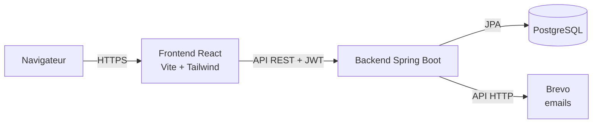

# DevManager

**Application web de gestion d'entreprise** : gestion des projets, suivi budgétaire et messagerie interne, réunis dans un seul outil.


<!-- Après le déploiement : ajouter ici le lien de la démo en ligne et les captures d'écran -->

---

## Sommaire

- [Contexte](#contexte)
- [Fonctionnalités](#fonctionnalités)
- [Stack technique](#stack-technique)
- [Architecture](#architecture)
- [Rôles et permissions](#rôles-et-permissions)
- [API REST](#api-rest)
- [Installation en local](#installation-en-local)
- [Variables d'environnement](#variables-denvironnement)
- [Tests](#tests)
- [Docker](#docker)
- [Structure du projet](#structure-du-projet)
- [Choix techniques](#choix-techniques)

---

## Contexte

Dans beaucoup d'entreprises, le suivi des projets se fait sur des tableurs, les budgets dans un autre fichier et la communication par emails dispersés. **DevManager centralise ces trois besoins** :

- savoir où en est chaque projet et qui y travaille ;
- suivre en temps réel le budget consommé et détecter les dépassements ;
- échanger avec les membres de l'équipe sans quitter l'application.

## Fonctionnalités

### 🔐 Authentification et sécurité
- Inscription et connexion avec **jeton JWT**
- **Mot de passe oublié** : lien unique envoyé par email, valable 30 minutes et utilisable une seule fois
- Trois rôles (**Administrateur, Manager, Employé**) avec des droits différents
- Mots de passe hachés avec **BCrypt**, jamais renvoyés par l'API

### 📁 Gestion de projets
- Création, modification et suppression de projets
- Statut (À faire, En cours, Terminé), dates, description
- Constitution de l'équipe (responsable et membres)
- Filtre par statut et recherche par nom

### 💰 Suivi budgétaire
- Budget alloué par projet, en francs CFA
- Saisie des dépenses par catégorie (salaires, matériel, logiciels, déplacements…)
- Calcul automatique du montant dépensé, du reste et du **pourcentage consommé**
- **Alerte visuelle en cas de dépassement** de budget

### 💬 Messagerie interne
- Boîte de réception et messages envoyés
- Compteur de **messages non lus** dans le menu
- Réponse rapide avec destinataire et sujet pré-remplis

### 📊 Tableau de bord
- Chiffres clés : nombre de projets, budget total, montant dépensé, messages non lus
- Répartition des projets par statut
- Projets qui consomment le plus leur budget

### 👥 Administration
- Liste des utilisateurs et **changement de rôle** (réservé à l'administrateur)

## Stack technique

| Couche | Technologies |
|---|---|
| **Backend** | Java 21, Spring Boot 4, Spring Security, Spring Data JPA, Bean Validation, Lombok |
| **Authentification** | JWT (bibliothèque jjwt), BCrypt |
| **Base de données** | PostgreSQL (production), H2 en mémoire (développement et tests) |
| **Frontend** | React 19, Vite, React Router, Axios, Tailwind CSS 4, Lucide (icônes) |
| **Emails** | API Brevo |
| **Tests** | JUnit 5, MockMvc, AssertJ, `@DataJpaTest` (approche TDD) |
| **DevOps** | Docker (builds multi-étapes), Docker Compose, Nginx, Git |

## Architecture



Le backend suit une **architecture en couches**, organisée **par fonctionnalité** :

```
Controller  →  Service  →  Repository  →  Base de données
(routes HTTP)  (règles métier) (accès aux données)
```

- Les **controllers** reçoivent les requêtes et valident les données (`@Valid`).
- Les **services** appliquent les règles métier et les droits d'accès.
- Les **DTO** (records Java) définissent ce que l'API expose : les entités ne sont jamais renvoyées directement.
- Un **gestionnaire global d'erreurs** renvoie des réponses JSON claires avec le bon code HTTP.

## Rôles et permissions

| Action | Administrateur | Manager | Employé |
|---|:---:|:---:|:---:|
| Voir les projets | Tous | Tous | Ceux dont il est membre |
| Créer un projet | ✅ | ✅ | ❌ |
| Modifier ou supprimer un projet | Tous | Les siens | ❌ |
| Ajouter ou supprimer des dépenses | Tous | Les siens | ❌ |
| Changer le statut d'un projet | ✅ | Les siens | Ceux dont il est membre |
| Envoyer et lire ses messages | ✅ | ✅ | ✅ |
| Changer le rôle d'un utilisateur | ✅ | ❌ | ❌ |

Le premier compte créé devient automatiquement **administrateur**.

## API REST

Toutes les routes, sauf `/api/auth/**` et `/api/health`, nécessitent l'en-tête `Authorization: Bearer <jeton>`.

<details>
<summary><strong>Voir toutes les routes</strong></summary>

| Méthode | Route | Description |
|---|---|---|
| POST | `/api/auth/register` | Créer un compte |
| POST | `/api/auth/login` | Se connecter et recevoir un jeton JWT |
| POST | `/api/auth/forgot-password` | Demander un lien de réinitialisation |
| POST | `/api/auth/reset-password` | Choisir un nouveau mot de passe |
| GET | `/api/users/me` | Profil de l'utilisateur connecté |
| GET | `/api/users` | Liste des utilisateurs |
| PATCH | `/api/users/{id}/role` | Changer un rôle (administrateur) |
| GET | `/api/projects` | Projets visibles par l'utilisateur |
| GET | `/api/projects/{id}` | Détail d'un projet et résumé budgétaire |
| POST | `/api/projects` | Créer un projet |
| PUT | `/api/projects/{id}` | Modifier un projet |
| PATCH | `/api/projects/{id}/status` | Changer le statut |
| DELETE | `/api/projects/{id}` | Supprimer un projet et ses dépenses |
| GET | `/api/projects/{id}/expenses` | Dépenses d'un projet |
| POST | `/api/projects/{id}/expenses` | Ajouter une dépense |
| DELETE | `/api/expenses/{id}` | Supprimer une dépense |
| GET | `/api/messages/inbox` | Messages reçus |
| GET | `/api/messages/sent` | Messages envoyés |
| GET | `/api/messages/unread-count` | Nombre de messages non lus |
| GET | `/api/messages/{id}` | Lire un message |
| POST | `/api/messages` | Envoyer un message |
| PATCH | `/api/messages/{id}/read` | Marquer un message comme lu |
| GET | `/api/dashboard` | Statistiques du tableau de bord |
| GET | `/api/health` | État de l'API (public) |

Exemple d'erreur de validation :

```json
{
  "status": 400,
  "message": "Données invalides",
  "errors": { "email": "Email invalide", "password": "Le mot de passe doit contenir au moins 8 caractères" }
}
```

</details>

## Installation en local

**Prérequis :** Java 21 et Node.js 20 ou plus récent. Maven et PostgreSQL ne sont pas nécessaires : le projet inclut le Maven Wrapper et utilise une base H2 en mémoire en développement.

```bash
git clone https://github.com/TAGUE-GITH/DevManager.git
cd DevManager
```

**1. Backend** (http://localhost:8080)

```bash
cd backend
./mvnw spring-boot:run
```

Sous Windows, utilisez `mvnw.cmd spring-boot:run`.

**2. Frontend** (http://localhost:5173), dans un second terminal :

```bash
cd frontend
npm install
npm run dev
```

Ouvrez http://localhost:5173 et créez un compte : le premier sera administrateur.

> En développement, le lien « mot de passe oublié » s'affiche dans la console du backend si aucune clé Brevo n'est configurée.

## Variables d'environnement

Aucun secret n'est écrit dans le code : tout passe par des variables d'environnement.

**Backend**

| Variable | Description | Valeur par défaut |
|---|---|---|
| `SPRING_PROFILES_ACTIVE` | `dev` (H2) ou `prod` (PostgreSQL) | `dev` |
| `DATABASE_URL` | URL JDBC PostgreSQL, ex. `jdbc:postgresql://hote:5432/base` | (profil prod) |
| `DATABASE_USERNAME` | Utilisateur PostgreSQL | (profil prod) |
| `DATABASE_PASSWORD` | Mot de passe PostgreSQL | (profil prod) |
| `JWT_SECRET` | Clé de signature des jetons (32 caractères minimum) | clé de développement |
| `JWT_EXPIRATION_MS` | Durée de validité d'un jeton | `86400000` (24 h) |
| `FRONTEND_URL` | URL du frontend (CORS et liens envoyés par email) | `http://localhost:5173` |
| `BREVO_API_KEY` | Clé API Brevo pour l'envoi d'emails | vide (lien dans les logs) |
| `MAIL_SENDER_EMAIL` | Adresse d'expédition, vérifiée dans Brevo | `no-reply@devmanager.local` |
| `PORT` | Port HTTP | `8080` |

**Frontend**

| Variable | Description |
|---|---|
| `VITE_API_URL` | URL du backend en production. Laisser vide en développement : Vite redirige `/api` vers le backend. |

## Tests

Le backend compte **34 tests automatisés** :

```bash
cd backend
./mvnw test
```

| Type | Ce qui est testé |
|---|---|
| **Intégration** (MockMvc) | Inscription, connexion, routes protégées, réinitialisation du mot de passe, droits par rôle sur les projets et les dépenses, confidentialité des messages, tableau de bord |
| **Repository** (`@DataJpaTest`) | Requêtes personnalisées : total des dépenses, messages non lus |
| **Unitaires** | Génération et validation des jetons JWT (valide, expiré, mauvaise signature), envoi d'emails avec un faux serveur Brevo |

Côté frontend, le code est vérifié avec le linter **oxlint** (`npm run lint`).

## Docker

Toute l'application (PostgreSQL, backend, frontend) démarre avec une seule commande :

```bash
docker compose up --build
```

Puis ouvrez http://localhost:3000. Pour personnaliser les secrets, copiez `.env.example` en `.env`.

- **Backend** : build multi-étapes (JDK pour compiler, JRE seul dans l'image finale), exécuté avec un utilisateur non-root.
- **Frontend** : application React compilée puis servie par **Nginx**, qui transmet aussi les appels `/api` au backend.
- **Base de données** : le backend attend que PostgreSQL soit prêt grâce à un healthcheck.

## Structure du projet

```
DevManager/
├── backend/                     API REST Spring Boot
│   └── src/main/java/com/devmanager/
│       ├── auth/                Inscription, connexion, mot de passe oublié, emails
│       ├── security/            JWT, filtre d'authentification, configuration Spring Security
│       ├── user/                Utilisateurs et rôles
│       ├── project/             Projets
│       ├── budget/              Dépenses
│       ├── message/             Messagerie
│       ├── dashboard/           Statistiques
│       └── common/              Gestion des erreurs, santé de l'API
├── frontend/                    Application React
│   └── src/
│       ├── api/                 Client Axios et appels à l'API
│       ├── context/             État d'authentification
│       ├── hooks/               Hooks personnalisés (chargement des données)
│       ├── components/          Composants réutilisables (UI, mise en page, formulaires)
│       ├── pages/               Pages de l'application
│       └── utils/               Formatage (FCFA, dates) et règles d'affichage
└── docker-compose.yml
```

## Choix techniques

- **JWT sans session** : l'API est sans état (*stateless*), ce qui facilite le déploiement et la montée en charge.
- **`BigDecimal` pour les montants** : aucune erreur d'arrondi, contrairement à `double`.
- **Réinitialisation de mot de passe sécurisée** : la réponse est identique que l'email existe ou non, ce qui empêche de deviner les comptes existants. Le jeton expire et ne sert qu'une fois.
- **Envoi d'emails derrière une interface** (`PasswordResetNotifier`) : on change de fournisseur sans toucher à la logique métier. Brevo passe par une API HTTP, car beaucoup d'hébergeurs gratuits bloquent le SMTP.
- **Droits vérifiés côté serveur** : l'interface masque les actions interdites, mais c'est le backend qui fait foi.
- **Profils Spring** : H2 en développement (aucune installation), PostgreSQL en production.
- **Accessibilité** : champs étiquetés, erreurs reliées aux champs, dépassement de budget signalé par une icône et un texte, et pas seulement par la couleur.

## Auteur

**TAGUE** · [GitHub](https://github.com/TAGUE-GITH)
