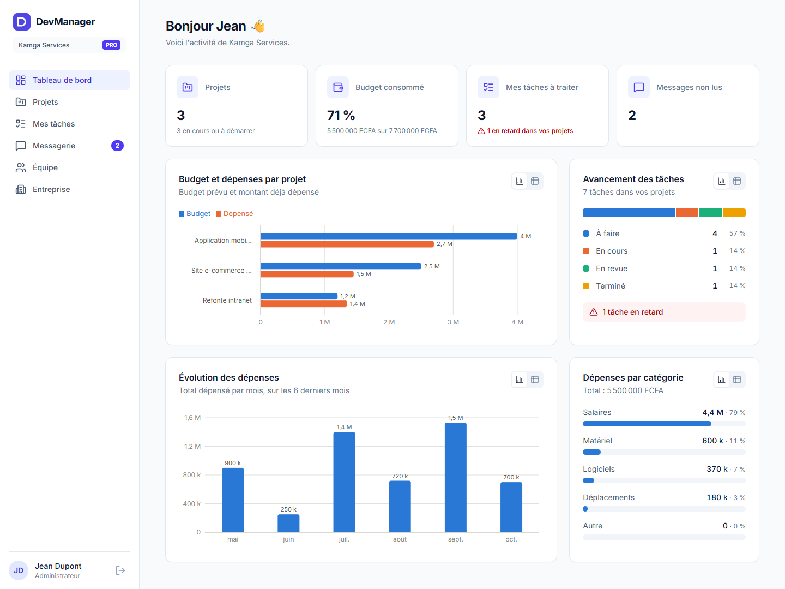
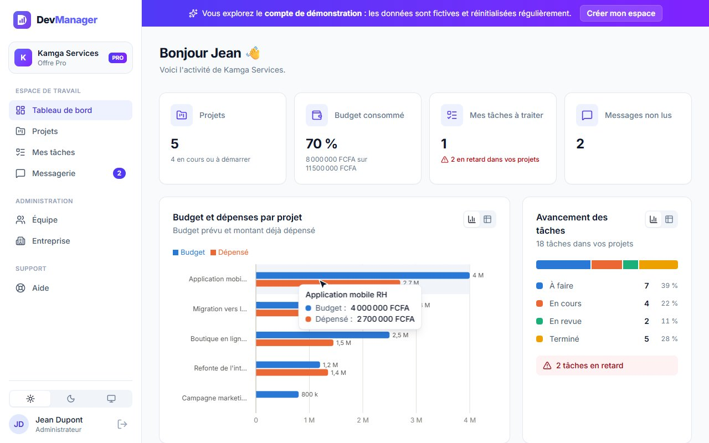
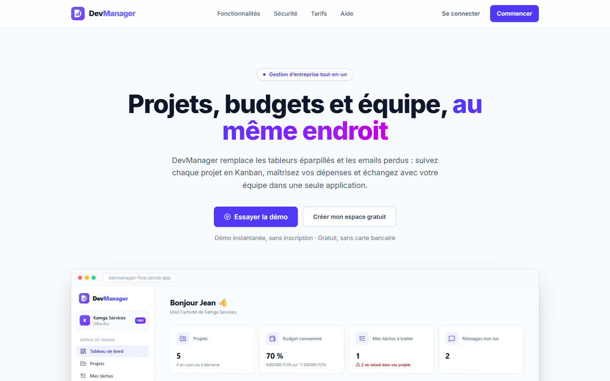
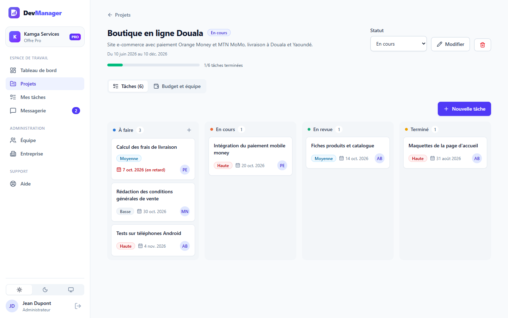
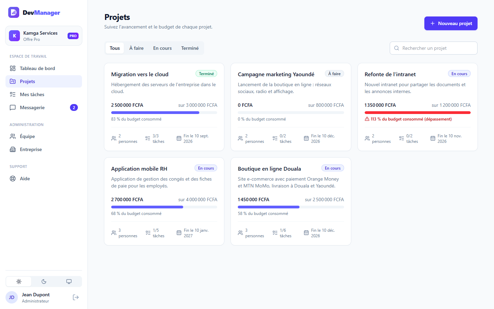
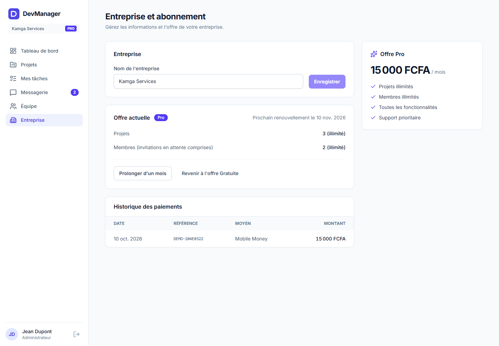
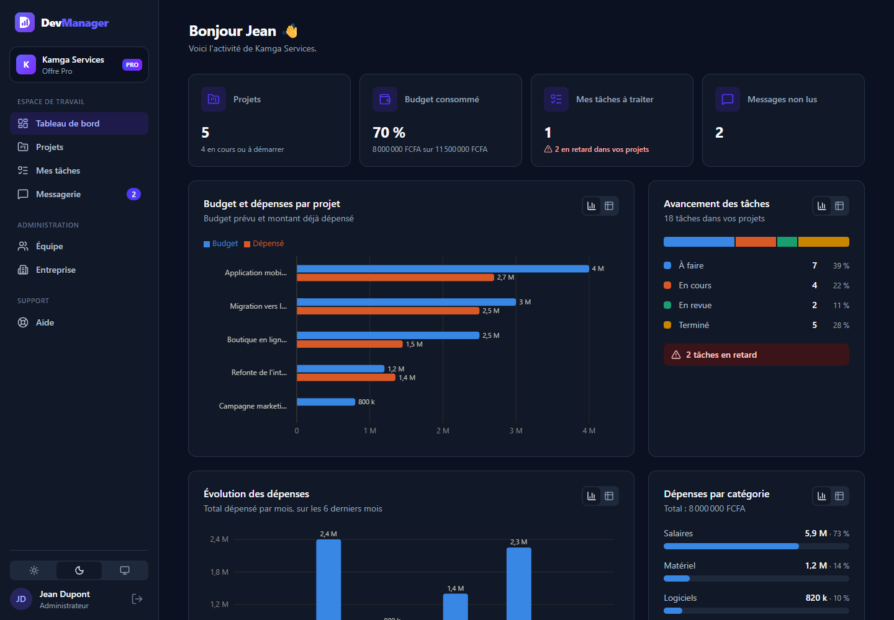
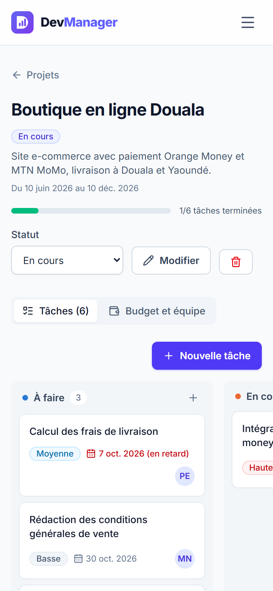
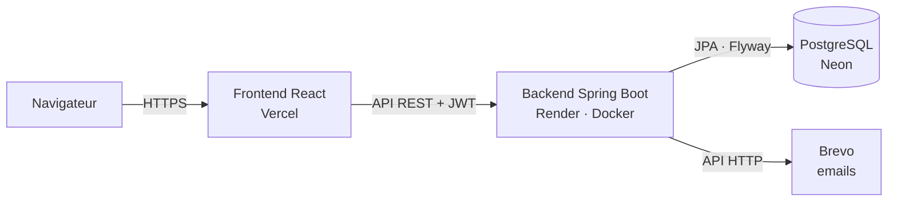

<p align="center"></p>

<h1 align="center">DevManager</h1>

**Application SaaS de gestion d'entreprise** : projets et tâches en Kanban, suivi budgétaire, messagerie interne et tableau de bord visuel. Chaque entreprise dispose de son propre espace isolé, avec une offre Gratuite et une offre Pro.

**🔗 Démo en ligne : [devmanager-five.vercel.app](https://devmanager-five.vercel.app)** · cliquez sur **« Essayer la démo »** pour explorer une entreprise déjà remplie, sans inscription.




### 🎬 Vidéo de présentation (37 s)

[](https://devmanager-five.vercel.app/demo/devmanager-demo.mp4)

*Cliquez sur l'image pour lancer la vidéo : compte de démonstration, tableau de bord, Kanban, messagerie et mode sombre.*

---

## Sommaire

- [Contexte](#contexte)
- [Captures d'écran](#captures-décran)
- [Fonctionnalités](#fonctionnalités)
- [Stack technique](#stack-technique)
- [Architecture](#architecture)
- [Rôles et permissions](#rôles-et-permissions)
- [API REST](#api-rest)
- [Installation en local](#installation-en-local)
- [Variables d'environnement](#variables-denvironnement)
- [Tests](#tests)
- [Application mobile](#application-mobile)
- [Docker](#docker)
- [Déploiement](#déploiement)
- [Structure du projet](#structure-du-projet)
- [Choix techniques](#choix-techniques)

---

## Contexte

Dans beaucoup d'entreprises, le suivi des projets se fait sur des tableurs, les budgets dans un autre fichier et la communication par emails dispersés. **DevManager centralise ces besoins** dans une seule application :

- savoir où en est chaque projet, qui fait quoi, et quelles tâches sont en retard ;
- suivre en temps réel le budget consommé et détecter les dépassements ;
- échanger avec les membres de l'équipe sans quitter l'application.

L'application est pensée comme un **SaaS multi-entreprise** : chaque entreprise s'inscrit, invite son équipe et travaille dans un espace dont les données sont strictement isolées des autres.

## Captures d'écran

| Page d'accueil | Tâches en Kanban |
|---|---|
|  |  |

| Projets | Entreprise et abonnement |
|---|---|
|  |  |

| Mode sombre |
|---|
|  |

<p align="center"></p>
<p align="center"><em>Version mobile : le tableau Kanban défile horizontalement</em></p>

## Fonctionnalités

### 🚀 Compte de démonstration
- Bouton **« Essayer la démo »** : connexion en un clic à une entreprise fictive déjà remplie (5 projets, 18 tâches, 6 mois de dépenses, messages)
- Dates calculées par rapport à aujourd'hui : les graphiques sont toujours à jour
- Données **recréées automatiquement toutes les 6 heures**
- Sécurisé : adresses en `.example` (aucun email envoyé), invitations désactivées

### 🏢 Multi-entreprise
- Inscription d'une **entreprise** : son créateur en devient l'administrateur
- **Invitations par email** avec un rôle choisi (lien unique valable 7 jours), ou lien à copier
- **Données isolées** : une entreprise ne voit jamais les projets, membres ou messages d'une autre

### 🔐 Authentification et sécurité
- Connexion par **jeton JWT**, mots de passe hachés avec **BCrypt**
- **Mot de passe oublié** : lien unique par email, valable 30 minutes et utilisable une seule fois
- Trois rôles (**Administrateur, Manager, Employé**), et plusieurs administrateurs possibles

### 📋 Projets et tâches Kanban
- Projets avec statut, dates, équipe (responsable et membres) et budget
- **Tableau Kanban** : À faire, En cours, En revue, Terminé
- **Glisser-déposer** à la souris, au doigt ou **au clavier**
- Tâches avec priorité, échéance (alerte si en retard) et personne assignée
- Page **« Mes tâches »** et barre d'avancement de chaque projet

### 💰 Suivi budgétaire
- Budget en francs CFA, dépenses par catégorie
- Calcul automatique du dépensé, du reste et du pourcentage consommé
- **Alerte en cas de dépassement**

### 📊 Tableau de bord visuel
- Chiffres clés : projets, budget consommé, tâches à traiter, messages non lus
- Graphiques : **budget et dépenses par projet**, **évolution mensuelle**, **répartition par catégorie**, **avancement des tâches**
- Infobulles au survol et **vue tableau** de chaque graphique (accessibilité)

### 💬 Messagerie interne
- Boîte de réception, messages envoyés, compteur de non lus, réponse rapide

### 🎥 Réunions vidéo
- Une **salle de réunion par projet** (Jitsi Meet), ouverte dans l'application
- **Appels de groupe**, micro, discussion et **partage d'écran**
- Nom et photo de l'utilisateur transmis automatiquement, salle réservée aux membres du projet

### 👤 Profil et image de l'entreprise
- **Photo de profil**, nom, poste et changement de mot de passe
- **Logo de l'entreprise** affiché dans le menu de tous les membres
- Images recadrées et compressées dans le navigateur avant l'envoi

### 🎨 Interface
- **Bilingue français / anglais** : interface, centre d'aide, dates, montants, messages d'erreur du serveur et réunions vidéo
- **Mode sombre** (clair, sombre ou réglage du système), graphiques adaptés
- **Centre d'aide** avec recherche, accessible sans compte ([/aide](https://devmanager-five.vercel.app/aide))
- Responsive, accessible au clavier, respect du réglage « réduire les animations »

### 💳 Offres Gratuit et Pro
- **Gratuit** : 3 projets et 5 membres ; **Pro** : illimité, 15 000 FCFA par mois
- Blocage clair des limites (réponse HTTP 402) avec proposition de passer en Pro
- Page **Entreprise et abonnement** : utilisation, paiement, historique, résiliation
- **Paiement en mode démonstration** : aucun prélèvement réel, aucune coordonnée bancaire demandée

## Stack technique

| Couche | Technologies |
|---|---|
| **Backend** | Java 21, Spring Boot 4, Spring Security, Spring Data JPA, Bean Validation, Lombok |
| **Base de données** | PostgreSQL (production, Neon), H2 en mode PostgreSQL (développement et tests), **Flyway** (migrations versionnées) |
| **Authentification** | JWT (jjwt), BCrypt |
| **Frontend** | React 19, Vite, React Router, Axios, Tailwind CSS 4, Recharts, dnd-kit, i18next, Lucide |
| **Visioconférence** | Jitsi Meet (API intégrée) |
| **Emails** | API Brevo |
| **Tests** | JUnit 5, MockMvc, AssertJ, `@DataJpaTest`, MockRestServiceServer |
| **Médias** | Captures et vidéo générées automatiquement (Puppeteer, Edge) |
| **DevOps** | Docker (builds multi-étapes), Docker Compose, Nginx, Render, Vercel, Git |

## Architecture



Le backend suit une **architecture en couches**, organisée **par fonctionnalité** :

```
Controller  →  Service  →  Repository  →  Base de données
(routes HTTP)  (règles métier, droits)  (accès aux données)
```

- Les **DTO** (records Java) définissent ce que l'API expose : les entités ne sont jamais renvoyées directement.
- **Toutes les requêtes sont filtrées par entreprise** dans les services : c'est la base du multi-entreprise.
- Un **gestionnaire global d'erreurs** renvoie des réponses JSON claires avec le bon code HTTP (400, 401, 402, 403, 404, 409).

## Rôles et permissions

| Action | Administrateur | Manager | Employé |
|---|:---:|:---:|:---:|
| Voir les projets | Tous | Tous | Ceux dont il est membre |
| Créer un projet | ✅ | ✅ | ❌ |
| Modifier ou supprimer un projet, gérer les dépenses | Tous | Les siens | ❌ |
| Créer et déplacer des tâches | ✅ | Projets dont il fait partie | Projets dont il est membre |
| Modifier ou supprimer une tâche | ✅ | Ses projets et ses tâches | Ses tâches |
| Messagerie | ✅ | ✅ | ✅ |
| Inviter des membres, changer les rôles | ✅ | ❌ | ❌ |
| Gérer l'entreprise et l'abonnement | ✅ | ❌ | ❌ |

## API REST

Toutes les routes, sauf `/api/auth/**` et `/api/health`, nécessitent l'en-tête `Authorization: Bearer <jeton>`.

<details>
<summary><strong>Voir toutes les routes</strong></summary>

| Méthode | Route | Description |
|---|---|---|
| POST | `/api/auth/register` | Créer une entreprise et son administrateur |
| POST | `/api/auth/login` | Se connecter |
| POST | `/api/auth/forgot-password` | Demander un lien de réinitialisation |
| POST | `/api/auth/reset-password` | Choisir un nouveau mot de passe |
| GET | `/api/auth/invitations/{token}` | Informations d'une invitation (public) |
| POST | `/api/auth/accept-invitation` | Créer son compte à partir d'une invitation |
| GET / PUT | `/api/users/me` | Profil de l'utilisateur connecté, modification |
| PUT / DELETE | `/api/users/me/avatar` | Photo de profil |
| PUT | `/api/users/me/password` | Changer son mot de passe |
| GET | `/api/users` | Membres de l'entreprise |
| PATCH | `/api/users/{id}/role` | Changer un rôle (administrateur) |
| GET / POST / DELETE | `/api/invitations` | Invitations (administrateur) |
| GET / POST | `/api/projects` | Projets visibles, création |
| GET / PUT / DELETE | `/api/projects/{id}` | Détail, modification, suppression |
| PATCH | `/api/projects/{id}/status` | Changer le statut |
| GET | `/api/projects/{id}/meeting` | Salle de réunion vidéo du projet |
| GET / POST | `/api/projects/{id}/expenses` | Dépenses d'un projet |
| DELETE | `/api/expenses/{id}` | Supprimer une dépense |
| GET / POST | `/api/projects/{id}/tasks` | Tâches d'un projet |
| GET | `/api/tasks/mine` | Mes tâches |
| PUT / DELETE | `/api/tasks/{id}` | Modifier, supprimer une tâche |
| PATCH | `/api/tasks/{id}/move` | Déplacer une tâche (colonne et position) |
| GET / POST | `/api/messages` | Messages reçus (`/inbox`), envoyés (`/sent`), envoi |
| PATCH | `/api/messages/{id}/read` | Marquer comme lu |
| GET | `/api/dashboard` | Statistiques et données des graphiques |
| GET / PUT | `/api/organization` | Entreprise et utilisation (administrateur) |
| PUT / DELETE | `/api/organization/logo` | Logo de l'entreprise (administrateur) |
| GET | `/api/images/{id}` | Photo ou logo (public, identifiant aléatoire) |
| POST / DELETE | `/api/organization/subscription` | Passer en Pro, revenir en Gratuit |
| GET | `/api/health` | État de l'API (public) |

L'API répond dans la langue demandée par l'en-tête `Accept-Language` (`fr` par défaut, ou `en`). Exemple de limite d'offre atteinte :

```json
{
  "status": 402,
  "message": "L’offre Gratuite est limitée à 3 projets. Passez à l’offre Pro pour en créer davantage."
}
```

</details>

## Installation en local

**Prérequis :** Java 21 et Node.js 20 ou plus récent. Maven et PostgreSQL ne sont pas nécessaires : le projet inclut le Maven Wrapper et utilise une base H2 en mémoire en développement. Flyway crée les tables au démarrage.

```bash
git clone https://github.com/TAGUE-GITH/DevManager.git
cd DevManager
```

**1. Backend** (http://localhost:8080)

```bash
cd backend
./mvnw spring-boot:run
```

Sous Windows : `mvnw.cmd spring-boot:run`.

**2. Frontend** (http://localhost:5173), dans un second terminal :

```bash
cd frontend
npm install
npm run dev
```

Ouvrez http://localhost:5173 et créez votre entreprise.

> En développement, sans clé Brevo, les emails (invitations, mot de passe oublié) s'affichent dans la console du backend.

## Variables d'environnement

Aucun secret n'est écrit dans le code.

**Backend**

| Variable | Description | Valeur par défaut |
|---|---|---|
| `SPRING_PROFILES_ACTIVE` | `dev` (H2) ou `prod` (PostgreSQL) | `dev` |
| `DATABASE_URL` | URL JDBC, ex. `jdbc:postgresql://hote/base?sslmode=require` | (profil prod) |
| `DATABASE_USERNAME` / `DATABASE_PASSWORD` | Identifiants PostgreSQL | (profil prod) |
| `JWT_SECRET` | Clé de signature des jetons (32 caractères minimum) | clé de développement |
| `JWT_EXPIRATION_MS` | Durée de validité d'un jeton | `86400000` (24 h) |
| `FRONTEND_URL` | URL du frontend (CORS et liens des emails) | `http://localhost:5173` |
| `BREVO_API_KEY` | Clé API Brevo | vide (emails dans les logs) |
| `MAIL_SENDER_EMAIL` | Adresse d'expédition vérifiée dans Brevo | `no-reply@devmanager.local` |

**Frontend**

| Variable | Description |
|---|---|
| `VITE_API_URL` | URL du backend en production. Vide en développement : Vite redirige `/api` vers le backend. |

## Tests

Le backend compte **72 tests automatisés** :

```bash
cd backend
./mvnw test
```

| Domaine | Ce qui est testé |
|---|---|
| **Authentification** | Inscription d'entreprise, connexion, routes protégées, mot de passe oublié, jetons JWT |
| **Multi-entreprise** | Isolation stricte des projets, membres et messages entre deux entreprises |
| **Invitations** | Rôle attribué, invitation à usage unique, annulation, réservée aux administrateurs |
| **Projets, budget, tâches** | Droits par rôle, calculs budgétaires, assignation, réorganisation du Kanban, suppression en cascade |
| **Tableau de bord** | Regroupement des dépenses par mois et par catégorie, tâches en retard |
| **Offres** | Limites de l'offre Gratuite, passage en Pro, résiliation |
| **Démonstration** | Données pré-remplies, recréation après 6 heures, invitations bloquées, isolation |
| **Profil et images** | Photo, logo, mot de passe, images invalides refusées, restrictions du compte de démonstration |
| **Réunions** | Salle propre à chaque projet, accès réservé aux membres |
| **Langues** | Messages d'erreur et de validation en français (par défaut) et en anglais |
| **Emails** | Contenu des emails, échappement HTML, appel à Brevo simulé |

Les tests tournent sur H2 avec les **mêmes migrations Flyway** qu'en production, et Hibernate vérifie que le schéma correspond aux entités. Côté frontend, le code est vérifié par **oxlint** (`npm run lint`).

## Application mobile

Une application **Android / iOS** en **React Native (Expo)** est en cours de développement dans [`mobile/`](mobile/README.md). Elle utilise **la même API** que le site web (mêmes comptes et mêmes données) : connexion, inscription, compte de démonstration, session sécurisée et choix de la langue sont déjà disponibles.

```bash
cd mobile
npm install
npx expo start   # puis scanner le QR code avec Expo Go
```

## Docker

```bash
docker compose up --build
```

Puis ouvrez http://localhost:3000. Pour personnaliser les secrets, copiez `.env.example` en `.env`.

- **Backend** : build multi-étapes (JDK pour compiler, JRE seul dans l'image finale), utilisateur non-root.
- **Frontend** : application compilée et servie par **Nginx**, qui transmet aussi les appels `/api` au backend.
- **PostgreSQL** : le backend attend que la base soit prête grâce à un healthcheck.

## Déploiement

| Service | Rôle | Configuration |
|---|---|---|
| **Vercel** | Frontend | [`frontend/vercel.json`](frontend/vercel.json) |
| **Render** | Backend (image Docker) | [`render.yaml`](render.yaml) (Blueprint) |
| **Neon** | PostgreSQL | Connexion SSL |
| **Brevo** | Emails transactionnels | API HTTP |

Chaque `git push` sur `main` redéploie automatiquement le frontend et le backend. Les évolutions de la base sont appliquées par Flyway au démarrage, sans perte de données.

## Structure du projet

```
DevManager/
├── backend/                       API REST Spring Boot
│   └── src/main/
│       ├── java/com/devmanager/
│       │   ├── auth/              Inscription, connexion, mot de passe oublié
│       │   ├── organization/      Entreprises, offres, paiements
│       │   ├── invitation/        Invitations par email
│       │   ├── security/          JWT, filtre d'authentification, configuration
│       │   ├── user/              Utilisateurs et rôles
│       │   ├── project/           Projets et réunions vidéo
│       │   ├── task/              Tâches Kanban
│       │   ├── budget/            Dépenses
│       │   ├── message/           Messagerie
│       │   ├── dashboard/         Statistiques
│       │   ├── image/             Photos de profil et logos
│       │   ├── demo/              Compte de démonstration
│       │   ├── mail/              Envoi d'emails (Brevo ou logs)
│       │   └── common/            Erreurs traduites, langue, santé de l'API
│       └── resources/
│           ├── db/migration       Migrations Flyway (V1 à V6)
│           └── messages*.properties  Textes du serveur en français et en anglais
├── frontend/                      Application React
│   └── src/
│       ├── api/                   Client Axios et appels à l'API
│       ├── components/            UI, mise en page, Kanban, graphiques, formulaires
│       ├── context/               État d'authentification
│       ├── hooks/                 Chargement des données
│       ├── i18n/                  Traductions français et anglais
│       ├── pages/                 Pages (chargées à la demande)
│       └── utils/                 Formatage (FCFA, dates selon la langue), couleurs, règles d'affichage
├── mobile/                        Application mobile React Native (Expo)
├── docs/screenshots/              Captures d'écran
├── docker-compose.yml
└── render.yaml
```

## Choix techniques

- **Multi-entreprise par filtrage applicatif** : chaque requête est limitée à l'entreprise de l'utilisateur, et une ressource d'une autre entreprise répond « introuvable » (404) pour ne rien révéler. Des tests vérifient cette isolation.
- **Flyway plutôt que `ddl-auto=update`** : le schéma est versionné dans Git, identique en test et en production, et Hibernate ne fait que le valider.
- **JWT sans session** : API sans état, simple à déployer et à faire monter en charge.
- **`BigDecimal` pour les montants** : aucune erreur d'arrondi.
- **Emails derrière une interface** (`Mailer`) : on change de fournisseur sans toucher au métier. Brevo passe par une API HTTP, car les hébergeurs gratuits bloquent souvent le SMTP.
- **Paiement prêt pour un vrai prestataire** : le paiement simulé peut être remplacé par NotchPay, CinetPay ou Flutterwave (Mobile Money), sans changer les limites ni l'historique.
- **Droits vérifiés côté serveur** : l'interface masque les actions interdites, mais c'est le backend qui fait foi.
- **Performance** : pages chargées à la demande (*code splitting*). La page d'accueil ne télécharge pas les graphiques.
- **Traductions des deux côtés** : React affiche l'interface avec i18next, et Spring traduit les erreurs et les emails avec `MessageSource` selon l'en-tête `Accept-Language` envoyé automatiquement par le client.
- **Accessibilité** : glisser-déposer au clavier, vue tableau des graphiques, palette validée pour les daltoniens, alertes avec icône et texte, respect du réglage « réduire les animations ».

## Auteur

**TAGUE** · [GitHub](https://github.com/TAGUE-GITH)
